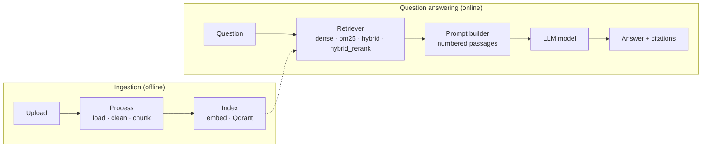

# RAG System

A modular, production-ready Retrieval-Augmented Generation (RAG) pipeline with an evaluation harness, built with Python and FastAPI.

---

## What is RAG?

Retrieval-Augmented Generation (RAG) is an AI architecture that enhances Large Language Model (LLM) responses by first **retrieving** relevant context from a curated knowledge base (vector database) and then **generating** answers grounded in that retrieved context. This approach minimizes hallucinations, ensures factual accuracy, and keeps responses aligned with your proprietary data.

---

## Architecture



See [docs/architecture.md](docs/architecture.md) for the request flow and design decisions.

---

## Project Structure

> In accordance with project conventions, only directories are listed below to illustrate architectural organization:

```
rag-system/
├── configs/                           # Application and pipeline configurations
│   └── experiments/                   # Experiment-specific configuration presets
├── data/                              # Local data storage (ignored by git)
│   ├── indexes/                       # Vector indices and database persistent storage
│   │   └── qdrant/                    # Local Qdrant vector database storage
│   ├── processed/                     # Parsed, cleaned, and chunked documents (JSONL)
│   └── raw/                           # Raw uploaded files partitioned by project_id
├── docs/                              # Project documentation and architectural records
│   └── decisions/                     # Architecture Decision Records (ADRs)
├── eval/                              # Evaluation harness datasets and benchmark outputs
│   └── reports/                       # Generated evaluation benchmark reports (JSON)
├── scripts/                           # CLI commands and evaluation utilities
├── src/                               # Main application source code
│   ├── api/                           # FastAPI web service layer
│   │   ├── routes/                    # API route handlers (data ingestion, search, ask, info)
│   │   └── schemas/                   # Pydantic request and response schemas
│   ├── core/                          # Core business logic and processing pipelines
│   │   ├── chunking/                  # Chunking strategies (fixed-size with overlap)
│   │   ├── evaluation/                # Retrieval evaluation logic (metrics, runner, golden set)
│   │   ├── generation/                # Prompt building, answer generation, citation extraction
│   │   ├── indexing/                  # Vector indexing and embedding orchestration
│   │   ├── ingestion/                 # Document ingestion, cleaning, and storage logic
│   │   │   └── loaders/               # Multi-format document loaders (PDF, DOCX, HTML, TXT, MD)
│   │   ├── llm/                       # LLM client (Google Gemini)
│   │   └── retrieval/                 # Information retrieval engines (dense retriever)
│   ├── infrastructure/                # Persistence and system infrastructure adapters
│   ├── models/                        # Core domain schemas, enums, and retry mechanisms
│   └── stores/                        # External storage adapters
│       ├── embedding/                 # Embedding model clients (Google Gemini, Remote HTTP)
│       └── vectordb/                  # Vector database clients (Qdrant)
└── tests/                             # Automated test suite
    ├── integration/                   # Integration and end-to-end tests
    └── unit/                          # Unit tests for components and API endpoints
```

---

## Key Features

- **Multi-Format Ingestion**: Load and parse `.pdf` (with page tracking via PyMuPDF), `.docx`, `.html` / `.htm`, `.txt`, and `.md` files. Includes file-type checking and maximum file size validation.
- **Robust Text Cleaning & Normalization**: Strips excessive whitespace, non-printable control characters, and normalizes formatting while preserving structural readability.
- **Configurable Chunking**: Fixed-size text chunker with configurable chunk size and overlap; preserves document source, page numbers, and character span offsets.
- **Flexible Embedding Providers**:
  - **Google Gemini API**: Native integration via `google-genai` (e.g. `text-embedding-004`).
  - **Remote HTTP Embedder**: HTTP client with exponential backoff and retry logic, compatible with any embedding server (such as `BAAI/bge-base-en-v1.5` or `all-MiniLM-L6-v2`).
  - **Free Colab GPU Server**: Included Jupyter notebook (`colab_embedding_server.ipynb`) to run sentence-transformers on a free Google Colab GPU over an ngrok tunnel.
- **Vector Database (Qdrant)**: Local persistent storage using Qdrant with project-scoped collections, metadata payloads, and configurable distance metrics (Cosine, Dot product).
- **Dense Semantic Retrieval**: High-performance vector retrieval with top-$k$ similarity filtering and score ranking.
- **Grounded Answer Generation**: `POST /api/ask/{project_id}` retrieves the best chunks, asks the LLM to answer *only* from them, and returns the answer with citations (source file, page and snippet). When the documents do not contain the answer, the system says so instead of guessing.
- **RESTful API (FastAPI)**: Clean REST endpoints with automatic OpenAPI documentation (`/docs`) for uploading, processing, indexing, resetting, and querying documents.
- **Comprehensive Evaluation Harness**:
  - Interactive CLI tool to generate golden question-chunk datasets (`scripts/build_golden_set.py`).
  - Sentence-level ground truth annotation tool (`scripts/annotate_answers.py`).
  - Automated benchmark runner (`scripts/run_eval.py`) reporting **Hit@1**, **Hit@3**, **Hit@5**, **Hit@10**, and **MRR** (Mean Reciprocal Rank) using $n$-gram shingle overlap.
  - JSON benchmark reporting stored under `eval/reports/`.

---

## Tech Stack

| Component | Technology | Description |
|---|---|---|
| **API Framework** | [FastAPI](https://fastapi.tiangolo.com/) + [Uvicorn](https://www.uvicorn.org/) | Asynchronous, high-performance web API |
| **Validation & Config** | [Pydantic v2](https://docs.pydantic.dev/) + [Pydantic-Settings](https://docs.pydantic.dev/latest/concepts/pydantic_settings/) | Strict type validation and environment settings |
| **Vector Database** | [Qdrant](https://qdrant.tech/) (`qdrant-client`) | High-performance vector search engine with local persistence |
| **Embeddings** | [Google GenAI SDK](https://github.com/google-gemini/generative-ai-python) / Remote HTTP | Gemini embeddings or self-hosted sentence-transformers |
| **Document Loaders** | PyMuPDF (`fitz`), python-docx, BeautifulSoup4 | Native parsing for PDF, Word documents, and HTML |
| **Generation** | Google Gemini (`google-genai`) | Answer generation from retrieved context |
| **Package Manager** | [uv](https://docs.astral.sh/uv/) | Extremely fast Python package manager and resolver |
| **Testing & Quality** | Pytest, Pytest-Cov, Ruff, Mypy | Test coverage, static linting, and strict type checking |

---

## Getting Started

### Prerequisites

- **Python**: `>= 3.12`
- **uv**: Recommended fast package installer (`curl -LsSf https://astral.sh/uv/install.sh | sh`)

### Installation

1. **Clone the repository**:
   ```bash
   git clone https://github.com/abuhussein1504/rag-system.git
   cd rag-system
   ```

2. **Set up the virtual environment and install dependencies**:
   ```bash
   uv sync
   source .venv/bin/activate    # On Windows: .venv\Scripts\activate
   ```

### Configuration

Create your `.env` configuration file from the provided template:

```bash
cp .env.example .env
```

Answer generation uses your existing `GOOGLE_API_KEY` plus these optional variables:

| Variable | Default | Description |
|---|---|---|
| `GENERATION_MODEL_ID` | `gemini-2.5-flash` | Gemini model used to write answers (check it matches a model your key can use) |
| `GENERATION_TEMPERATURE` | `0.0` | Keep low for factual answers |
| `DEFAULT_RETRIEVER` | `dense` | Retriever used by `/api/ask` when the request does not choose one: `dense`, `bm25`, `hybrid` or `hybrid_rerank` |

### Run the API

Start the FastAPI application with Uvicorn:

```bash
uv run uvicorn main:app --reload
```

The interactive OpenAPI documentation will be accessible at:
- **Swagger UI**: [http://127.0.0.1:8000/docs](http://127.0.0.1:8000/docs)
- **ReDoc**: [http://127.0.0.1:8000/redoc](http://127.0.0.1:8000/redoc)

---

## API Workflow & Endpoints

The system organizes documents under a `project_id` namespace, allowing multi-project isolation.

### 1. Check System Health
```bash
curl -X GET "http://127.0.0.1:8000/api/info/"
```

### 2. Upload Documents
Upload a supported file (`.pdf`, `.docx`, `.html`, `.txt`, `.md`) to project `project_1`:
```bash
curl -X POST "http://127.0.0.1:8000/api/data/upload/project_1" \
     -F "file=@/path/to/document.pdf"
```

### 3. Process & Chunk Documents
Parse raw documents, clean text, and generate chunks with overlap:
```bash
curl -X POST "http://127.0.0.1:8000/api/data/process/project_1?force=false"
```

### 4. Index Chunks into Vector DB
Generate vector embeddings and index them into Qdrant:
```bash
curl -X POST "http://127.0.0.1:8000/api/data/index/project_1"
```

### 5. Semantic Search / Retrieval
Query the indexed collection using dense vector search:
```bash
curl -X POST "http://127.0.0.1:8000/api/search/project_1" \
     -H "Content-Type: application/json" \
     -d '{"query": "What is the primary conclusion?", "top_k": 5}'
```

### 6. Ask a Question (grounded answer)
Retrieve the most relevant chunks and generate an answer that cites them:
```bash
curl -X POST "http://127.0.0.1:8000/api/ask/project_1" \
     -H "Content-Type: application/json" \
     -d '{"question": "How many vacation days do new employees get?", "top_k": 5}'
```
`retriever` (optional) overrides `DEFAULT_RETRIEVER` for a single request, e.g. `"retriever": "hybrid"`.

Example response (illustrative, for a project containing an employee handbook):
```json
{
  "answer": "New employees get 15 vacation days per year, accrued monthly [1]. Unused days can be carried over for up to 3 months [2].",
  "refused": false,
  "citations": [
    {
      "chunk_id": "3f9c1a7e5b20d4c8",
      "doc_id": "handbook",
      "source": "handbook.pdf",
      "page": 7,
      "snippet": "Section 4.2 Vacation. Full-time employees receive 15 days of paid vacation per year..."
    },
    {
      "chunk_id": "b81d6e02a9f4c735",
      "doc_id": "handbook",
      "source": "handbook.pdf",
      "page": 7,
      "snippet": "Unused vacation days may be carried over into the first three months of the next year..."
    }
  ]
}
```
If nothing relevant is found, or the model decides the passages do not answer the question, the response is `{"answer": "I don't know based on the provided documents.", "refused": true, "citations": []}`. If the language model is unreachable or out of quota, the endpoint returns `502`.

### 7. Reset / Delete Data
Delete project-specific data (scopes: `raw`, `processed`, `vectors`, or `all`):
```bash
curl -X DELETE "http://127.0.0.1:8000/api/data/project_1?scope=all"
```
Or reset all projects:
```bash
curl -X DELETE "http://127.0.0.1:8000/api/data?confirm=true"
```

---

## Evaluation Harness

The repository includes a complete retrieval evaluation pipeline to measure retrieval quality and avoid regressions.

### 1. Build Golden Set
Create a question-document benchmark dataset interactively from processed chunks:
```bash
uv run python scripts/build_golden_set.py --project project_1 --out eval/golden_set.jsonl
```

### 2. Annotate Ground Truth Answers
Annotate sentence-level ground truth answers for precise relevance evaluation:
```bash
uv run python scripts/annotate_answers.py --project project_1 --src eval/golden_set.jsonl --out eval/golden_set_v2.jsonl
```

### 3. Run Benchmark Evaluation
Run the evaluation runner against the indexed vector collection:
```bash
uv run python scripts/run_eval.py --project project_1 --name 01_dense_baseline --golden eval/golden_set.jsonl --k 10
```

The evaluator calculates:
- **Hit@1, Hit@3, Hit@5, Hit@10**: Proportion of queries where a relevant chunk was found within top $k$ results (based on 5-gram shingle matching).
- **MRR (Mean Reciprocal Rank)**: Average reciprocal rank of the first relevant retrieved document.
- Saves detailed JSON reports into `eval/reports/<name>.json`.

---

## Testing & Quality

Run the test suite with pytest:

```bash
uv run pytest
```

Run test coverage:

```bash
uv run pytest --cov=src
```

Run static analysis and linting:

```bash
uv run ruff check .
uv run mypy src
```

---

## License

This project is licensed under the [Apache License 2.0](LICENSE).
