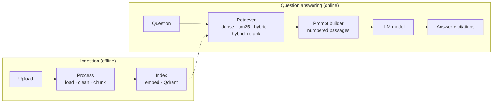

# Architecture

The system is split into an **offline ingestion pipeline** that turns files into an index, and an **online question-answering path** that turns a question into a cited answer. Every project (`project_id`) has its own raw files, processed chunks and Qdrant collection.

## Module map

| Path | Responsibility |
|---|---|
| `src/api/` | FastAPI routes (`data`, `search`, `ask`, `base`), request/response schemas, dependency wiring |
| `src/core/ingestion/` | File loaders (PDF, DOCX, HTML, TXT, MD), text cleaning, upload validation, processing to JSONL |
| `src/core/chunking/` | Chunking strategies (fixed-size with overlap) |
| `src/core/indexing/` | Embeds processed chunks and writes them to the vector store |
| `src/core/retrieval/` | `Retriever` implementations: dense, BM25, hybrid (reciprocal rank fusion), reranking wrapper, and the factory that builds them by name |
| `src/core/llm/` | `LLMClient` protocol and the concrete LLM client |
| `src/core/generation/` | Prompt building, answer generation, citation extraction |
| `src/core/evaluation/` | Golden set, retrieval metrics (Hit@k, MRR), runner |
| `src/stores/` | Adapters for embedders, rerankers and the vector database |
| `src/models/` | Domain schemas (`Chunk`, `RetrievedChunk`, `Answer`, `Citation`), enums, retry helper |

Everything in `core/` depends on small `Protocol` interfaces (`Retriever`, `Embedder`, `Reranker`, `VectorStore`, `LLMClient`), so backends can be swapped or faked in tests without touching the pipeline.

## Request flow: `POST /api/ask/{project_id}`

1. The route picks the retriever (`retriever` in the body, else `DEFAULT_RETRIEVER`) and builds it with `build_retriever`.
2. `AnswerGenerator.answer` retrieves `top_k` chunks. If there are none, it returns the refusal answer **without calling the LLM**.
3. `build_prompt` numbers the chunks `[1]..[n]` and labels each with its source file and page.
4. The LLM is called with a system prompt that restricts it to the passages and asks for `[n]` citations.
5. If the reply is the refusal sentence, the answer is marked `refused`. Otherwise the `[n]` markers are mapped back to chunks to build the citations (source, page, snippet).
6. An `LLMError` (network, quota, empty or blocked reply) is returned as HTTP `502`.

## Design decisions

- **Citations come from the passage numbers the model writes, not from "all retrieved chunks".** Only passages the answer actually relies on are returned, and numbers outside `1..n` are ignored, so the model cannot cite something that was not retrieved. If the model cites nothing, the answer is returned with an empty citation list and a warning is logged rather than inventing citations.
- **No score threshold for refusing.** Scores are not comparable across retrievers (cosine similarity, RRF, reranker logits), so refusal relies on "nothing retrieved" plus the model's own judgement under the strict system prompt. Revisit this once the evaluation covers answer quality.
- **Retrieved text is treated as untrusted data.** The system prompt tells the model to ignore instructions found inside passages. This is a first line of defence, not a complete one.
- **Synchronous routes.** Embedding, retrieval and LLM calls are blocking, so the routes are plain `def` and FastAPI runs them in its thread pool.

